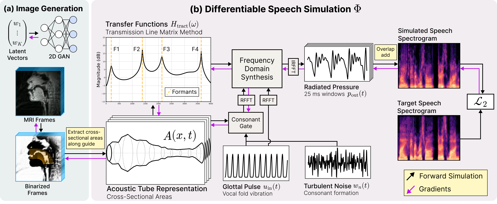

# Reconstructing the Vocal Tract with Differentiable Acoustic Simulation




**Reconstructing the Vocal Tract with Differentiable Acoustic Simulation** \
Eric Ming Chen, Jin Woo Lee, Vincent Sitzmann \
NeurIPS 2026 Spotlight Paper \
https://arxiv.org/abs/2609.36737 

*The vocal tract is the region of the human body responsible for filtering one's voice to create speech. In this paper, we present a differentiable and GPU accelerated acoustic simulator for the vocal tract. The differentiable simulator synthesizes speech by propagating sound along an acoustic tube model of the vocal tract, and via its gradients, can solve the inverse problem: reconstructing the shape of the vocal tract solely from the sound it produces. Although the inverse mapping between geometry and sound is notoriously non-convex, we discover that gradient descent succeeds with three technical contributions: (1) we design a frequency domain formulation of the vocal tract's fluid dynamics that is 70x more GPU parallelizable than finite differences in time, (2) we integrate a differentiable model for turbulence to synthesize consonants, and (3) similar to prior work in implicit neural representations (INRs) and neural fields, we find that parameterizing the geometry with a neural network accelerates convergence and escapes local minima that trap discrete representations. Because the simulator is differentiable, it is readily integrated with other deep learning pipelines to enable novel linguistics and medical imaging applications. (1) We demonstrate self-supervised autoencoding of vocal tract shapes across 11 languages, and (2) we couple our simulator with a generative model of MRI (magnetic resonance imaging) images to reconstruct one's moving vocal tract from only their speech without paired data.*

### Environment

To sync the environment, run:

```bash
uv sync
```

### Fitting an audio sample

To fit the 
`assets/jude.wav` recording with different neural field representations, run

```bash
uv run python -m difftlm.fit_sample --network all --output outputs/jude
```

The script first estimates the glottal pulse using SwiftF0, then optimizes the tube geometry to match the target audio. 500 training steps are used by default. 

Choose a representation with `--network`:

| Value | Representation |
| --- | --- |
| `cnn` | Convolutional encoder with a multiresolution grid (default). |
| `rff` | MLP with random Fourier features |
| `grid` | A single directly optimized grid |
| `multiscale-grid` | Directly optimized multiresolution grids |
| `mfn` | Multiplicative Fourier filter network |
| `all` | Run all five representations sequentially |


To fit your own recording, or run a shorter experiment:

```bash
uv run python -m difftlm.fit_sample \
    --path /path/to/audio.wav \
    --network rff \
    --duration 2.0 \
    --n-steps 200 \
    --output outputs/custom_rff
```

`--duration` selects the first N seconds; omit it to use the full recording.

### Tips and Tricks
Learning rate and area scale are the two most important parameters to scale when fitting a new sample. Optimal learning rates vary significantly depending on the neural field architecture used. 


### Nasal branch

`TransmissionLineSimulator.rollout_nasal` adds a nasal cavity to the tube model. The cavity couples to the vocal tract through a velopharyngeal port of area `A_vp` (cm², one value per frame). The method returns the mouth and nose outputs as far-field pressures. The microphone signal is their sum.

```python
import jax, jax.numpy as jnp, numpy as np
from difftlm.tract import TransmissionLineSimulator, SimulatorOptions

fit = np.load("outputs/jude/cnn/fit.npz")  # written by difftlm.fit_sample
uin, areas = jnp.asarray(fit["uin"]), jnp.asarray(fit["areas"])
sr = 32000
sim = TransmissionLineSimulator(
    SimulatorOptions(SR=sr, TF=(len(uin) + 0.5) / sr, L=17.5, fft_size=1024)  # +0.5: exact sample count
)
A_vp = jnp.full(sim.n_windows, 0.4)  # port area per frame (cm²); 0 closes the port
p_oral, p_nasal = sim.rollout_nasal(uin, areas, A_vp, L=sim.opt.L, key=jax.random.key(0))
audio = p_oral + p_nasal
```

- The nasal cavity has 19 sections (11.4 cm), with the area function of Dang, Honda & Suzuki (1994, subject 1) and four paranasal sinuses as Helmholtz resonators (Dang & Honda, 1996). The values follow [VocalTractLab](https://github.com/TUD-STKS/VocalTractLabBackend-dev). The first four sections blend from `A_vp` to the fixed nasal area.
- The port joins the oral tube at `port_fraction` of its sections from the glottis (default 0.55, about 9.3 cm for L = 17.5 cm). This position is an assumption. Set it per speaker.
- Both outputs are `jω·G·U`, with `U` the volume velocity at the lips or at the nostrils, so they add correctly. `far_field_ref_area` sets the gain `G`. Pressures at the two radiation impedances do not add correctly: they over-weight the smaller opening (by about 8 dB for 5 cm² lips and 0.76 cm² nostrils).
- At `A_vp = 0`, `rollout_nasal` approaches the far-field output of the unbranched tube. It does not equal `rollout`, which returns the pressure at the lip radiation impedance.
- Turbulence noise also radiates through the nose. The flows that drive the turbulence gate include the leak through the port.
- `A_vp` is clipped at 1e-4 cm², so its gradient is zero for a closed port. To optimise `A_vp`, parameterise it, for example with a softplus.

`TransmissionLineSimulator.transfer_functions` returns the frequency responses of one frame, with or without the nasal branch.


### Tests

```bash
uv run pytest
```

The tests compare every transfer function with an independent nodal solve of the same circuit.

The turbulence noise transfer functions (flow at each section, and noise to output) used to combine chain matrices from two different junctions. This is fixed. The voiced output is unchanged, but the noise level and spectrum differ from earlier versions.


### To Dos
- [ ] Upload autoencoder weights and code
- [ ] Add MRI experiments


### Citation
```
@inproceedings{Chen2026DiffTLM,
  author = {Chen, Eric Ming and Lee, Jin Woo and Sitzmann, Vincent},
  title = {Reconstructing the Vocal Tract with Differentiable Acoustic Simulation},
  booktitle = {Proc. NeurIPS},
  year = {2026}
}
```
